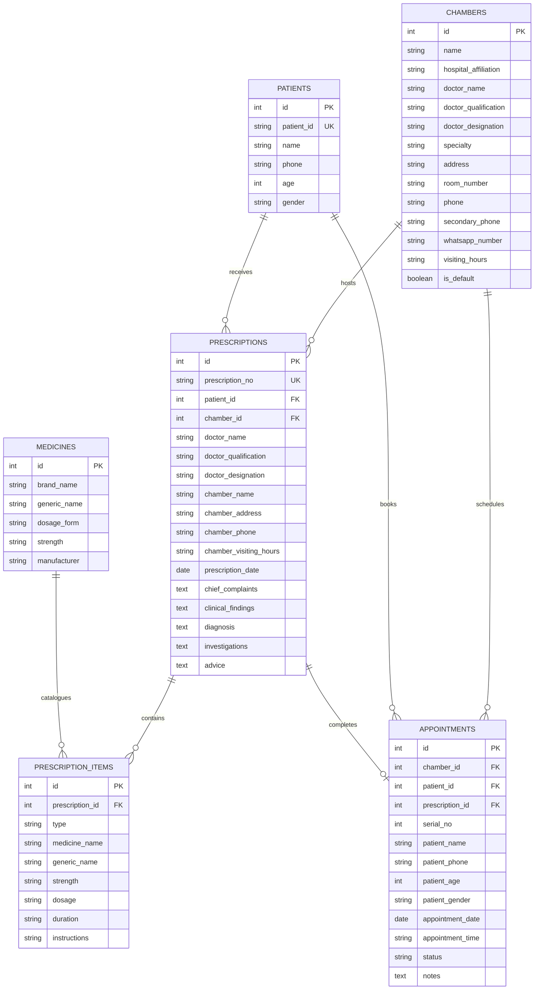

# Bikrify Prescription Studio (DOC-s-prescription)

[](https://laravel.com)
[](https://livewire.laravel.com)
[](https://php.net)
[](https://tailwindcss.com)
[](#automated-testing)

**Bikrify Prescription Studio** is a commercial-grade, offline-ready medical prescribing platform and patient queue management system designed specifically for medical doctors, hospital consultants, polyclinics, and receptionists in Bangladesh and global private practice.

---

## 🌟 Executive Feature Highlights

### 1. 🏥 Doctor Multi-Hospital Seating & Onboarding Customization
Doctors frequently practice across multiple hospitals and private chambers throughout the week. Bikrify provides seamless multi-hospital profile management:
- **1-Click Hospital Switcher**: Instantly switch between locations (e.g., *Square Hospital*, *Popular Diagnostic Center*, *Bikrify Banani Chamber*).
- **Comprehensive Profile Setup**:
  - Doctor Name, Medical Degrees & Qualifications (`MBBS, FCPS, MD, BCS (Health)`)
  - Institutional Designation & Department (e.g. *Professor & Chief Consultant, Department of Nephrology*)
  - Hospital Affiliation, Room/Chamber/Seat Number, and Floor
  - Seating Times & Visiting Hours (e.g. *5:00 PM - 9:00 PM, Sat-Wed*)
  - Serial Hotline Number, Personal Number, and a **Direct WhatsApp Hotline** with click-to-chat links (`https://wa.me/...`)
- **Onboarding Modal (`⚙️ Setup`)**: Bikrify onboarding agents or clinic administrators can customize or add new hospital profiles in seconds.

---

### 2. 🎯 Specialty-Driven Dynamic Clinical Templates
When a doctor selects their primary specialty, the clinical workspace dynamically morphs to provide specialty-tailored Chief Complaints, Examination (O/E), Diagnoses, Laboratory Investigations, and Special Advice:
- **Nephrology / CKD Specialist**: Full protocol for Chronic Kidney Disease (Stage 1-5, ESRD), Hypertensive Nephrosclerosis, Diabetic Nephropathy, Glomerulonephritis, S. Creatinine, eGFR, Spot ACR, KUB USG, low protein diets, and fluid restrictions.
- **Cardiology**: IHD, Angina, CCF, NSTEMI, Atrial Fibrillation, ECG, Echocardiography, Troponin-I, Lipid profiles, salt and cholesterol restrictions.
- **General Medicine / Internal Medicine**: Acute viral syndromes, Typhoid/Enteric fever, UTI, Dengue NS1 workups, pneumonia, and fever management.
- **Gastroenterology**: GERD, PUD, IBS, Endoscopy, H. Pylori, USG of whole abdomen, dietary acid reduction protocols.
- **Diabetology / Endocrinology**: Type 2 Diabetes Mellitus, Diabetic Neuropathy, HbA1c, microalbuminuria, lipid profiles, diabetic foot care, and blood sugar charts.

---

### 3. ⚡ Less-Input Automation (Near-Zero Doctor Typing)
Doctors spend valuable consultation time speaking with patients, not typing. Bikrify reduces keyboard input to near-zero:
- **1-Click Full Clinical Bundles**: Clicking e.g. **"⚡ 1-Click CKD Stage 4 Full Profile"** instantly auto-fills Complaints, Examination, Diagnosis, Investigations, and Special Advice in **literally 1 click**.
- **1-Click Specialty Medication Kits**:
  - **💊 CKD Core Drug Kit (4 Meds)**: Instantly adds `Ketosteril` (1+1+1 with meal), `Sodibicarb 500mg` (1+0+1 after meal), `Febux 40mg` (0+0+1 after meal), and `Calcichew D` (0+0+1 after meal).
  - **💊 Heart & BP Kit**: `Amlopin 5mg` + `Bizoran 5/20mg` + `Concor 2.5mg`.
  - **💊 Fever & Bodyache Kit**: `Napa Extra` + `Protonix 20mg` + `Alarid 10mg`.
  - **💊 Gastritis Relief Kit**: `Protonix 40mg` + `Motigut 10mg` + `Antacid Plus`.
  - **💊 Diabetes Starter Kit**: `Comet 500mg` + `Linaglip 5mg` + `Neobion`.
- **🩺 Fast Vitals Calculator**:
  - Enter BP Systolic/Diastolic (e.g. `160 / 95`) -> Auto-detects **Stage 2 HTN**.
  - Enter Pulse (`80 bpm`), RBS (`7.8 mmol/L`), Weight (`70 kg`), and Height (`165 cm`) -> Auto-calculates **BMI (25.7 Overweight)**.
  - **"+ Insert into O/E"** adds clean formatted vitals in 1 click.
- **📅 1-Click Follow-Up Date Generator**:
  - Click `[ + 7 Days ]`, `[ + 15 Days ]`, `[ + 1 Month ]`, or `[ + 3 Months ]` to compute the exact calendar return date (e.g., *Follow-up after 15 days on 25 Nov, 2026 with S. Creatinine report*) and append it to Doctor's Advice.

---

### 4. 🎙️ Browser-Native Voice Dictation (Speech-to-Text)
- **Zero Paid API Cost**: Uses browser-native Web Speech API (`SpeechRecognition`) in Google Chrome, Microsoft Edge, and Safari.
- **Bilingual Support**: Toggle between **English (Medical Terminology)** and **বাংলা (Bengali - `bn-BD`)**.
- **Dedicated Voice Mics**: Available on Chief Complaints, Examination (O/E), Diagnosis, Investigations, and Special Advice. Clicking turns the mic pulsing red (`🎙️ Listening...`) and transcribes spoken words directly into the textarea.

---

### 5. 👥 Patient Queue & "No-Receptionist" Self-Booking Ecosystem

#### Case A: Doctor HAS a Receptionist (`/appointments`)
- **Receptionist Queue Desk**: Receptionists enter Patient Name, Age, Gender, Phone, and preferred Time Slot.
- **Automatic Serial Token Generation**: Issues serial tokens (`#1`, `#2`, `#3`...) for the date.
- **WhatsApp Confirmation**: 1-click button to send appointment confirmations directly to the patient's WhatsApp.
- **Live Sync with Doctor Studio**: The doctor sees a **"LIVE QUEUE"** banner at the top of the Prescription Studio. Clicking **"Call Patient #1"** automatically loads their details into the prescription. Saving the prescription marks the queue token as `Completed`.

#### Case B: Doctor HAS NO Receptionist (Solo Practice Solution)
- **Public Patient Self-Booking Portal (`/book/{chamber_id}`)**:
  - Mobile-first, privacy-protected portal where patients book from their phone.
  - Instantly generates an electronic **Serial Token Card** with live waiting counter (shows who is currently inside with the doctor and how many patients are ahead).
- **Printable Chamber Door QR Standee Poster (`/chambers/{chamber}/qr-standee`)**:
  - Professional A4 standee poster featuring the Doctor's photo/credentials, hospital name, room number, visiting hours, and a **large scannable QR Code**.
  - Bilingual instructions: *"Scan with Phone Camera to Get Serial Token"* / *"আপনার মোবাইল ক্যামেরা দিয়ে স্ক্যান করে সিরিয়াল টোকেন নিন"*.
  - Ready to print, laminate, and place outside the chamber door or share on social media/WhatsApp.

---

### 6. 🔍 Old Patient Lookup & Past Prescription History
- **Live Search**: Search by Phone Number (`017...`), Patient Name, or Patient ID (`PID-XXXX`).
- **History Drawer**: When an existing patient is loaded, click **"📋 Past Visits"** to view previous consultation dates, diagnoses, complaints, and prescribed medicines.
- **1-Click "Repeat Previous Rx"**: Copy all medicines and dosages from their previous visit into the builder with one click—ideal for chronic patients (CKD, hypertension, diabetes) coming for refills.

---

### 7. 💊 High-Performance Medicine Database & Fast Dropdowns
- **Comprehensive Bangladesh DGDA Dataset**: Pre-seeded with complete brand variant families:
  - **Napa**: `Napa 500mg`, `Napa Extra 500+65mg`, `Napa Extend 665mg`, `Napa One 1000mg`, `Napa Rapid`, `Napa Suspension`, `Napa Paediatric Drop`, `Napa Suppository (125/250/500mg)`, `Napa IV Infusion`.
  - **Ace**: `Ace 500mg`, `Ace Plus`, `Ace Power 1000mg`, `Ace Suspension`.
  - **CKD / Nephrology**: `Ketosteril`, `Ulsicral`, `Eprex / Epotin 4000 & 10000 IU`, `Sodibicarb`, `Febux`, `Rocaltrol / Bonitrol`, `Torsid`, `Lasix`, `Renvela`, `Calcichew D`, `Amlopin`, `Bizoran`, `Angilock`, `Concor`, `Iron Sucrose`.
- **Tokenized Search**: Typing `napa extra`, `napa`, or `paracetamol` matches all corresponding variants with prefix prioritization.
- **100% Manual Flexibility**: Doctors can also type any custom/new medicine name freely.
- **Fast Preset Datalists**:
  - **Form**: `Tab.`, `Cap.`, `Inj.`, `Syr.`, `Drop`, `Oint.`, `Inhaler`, `Supp.`
  - **Timing**: `1+0+0` (সকালে), `0+1+0` (দুপুরে), `0+0+1` (রাতে), `1+0+1` (সকাল + রাত), `1+1+1` (৩ বেলা), `1+1+1+1` (৪ বেলা), `1/2+0+1/2`, `1 spoon 3 times`, `2 puffs twice daily`, `As needed (PRN)`.
  - **Duration**: `3 days`, `5 days`, `7 days`, `10 days`, `14 days`, `1 month`, `2 months`, `3 months`, `Continue (চলবে)`.
  - **Instructions**: `After meal (খাবার পরে)`, `Before meal (খাবার আগে)`, `With meal (খাবারের সাথে)`, `Empty stomach (খালি পেটে)`, `At bedtime (ঘুমানোর আগে)`, `Before breakfast`, `After breakfast`, `As directed`.

---

### 8. 🖨️ Professional Printing, WhatsApp Sharing & PDF Layouts
- **A4 Pad Layout (`/prescriptions/{id}/print`)**: Clean, publication-grade layout with Doctor Header, Patient Strip, Dual Clinical/Rx columns, and Doctor Signature block.
- **Pre-printed Letterhead Pad Mode**: Toggle to hide HTML headers and customize the top margin spacer (`40mm`, `50mm`, `60mm`, `70mm`) so it aligns with physical hospital letterhead pads.
- **💬 Direct WhatsApp Prescription Sharing**: Sends a pre-formatted message with a direct view/download link to the patient's WhatsApp number.
- **📄 Download PDF**: High-speed server-side PDF generation powered by `barryvdh/laravel-dompdf`.
- **🧪 Diagnostic Lab Test Requisition Slip (`/prescriptions/{id}/investigations`)**: Generates a dedicated lab referral voucher with test checkboxes, clinical diagnosis, and doctor sign-off.

---

### 9. 📊 Practice Analytics Dashboard (`/dashboard`)
- Real-time statistics: Total Consultations, Today's Consultations, Monthly Count, Registered Patients.
- Practice breakdown across multiple hospitals and chambers.
- Top 5 clinical diagnoses with visual progress bars.
- Top 5 prescribed medications.
- Patient gender and demographic distribution.
- Recent prescriptions table with direct A4 print and PDF download buttons.

---

## 🗺️ Route Sitemap

| Route Path | Method | Route Name | Purpose |
|------------|--------|------------|---------|
| `/` | `GET` | `prescription.builder` | **Doctor Prescription Studio** (Interactive Rx Builder) |
| `/dashboard` | `GET` | `doctor.dashboard` | **Doctor Practice Analytics** (Reports & Metrics) |
| `/prescriptions` | `GET` | `prescription.list` | **Prescription Archive** (Search, Filter, Reprint) |
| `/prescriptions/{id}/print` | `GET` | `prescription.print` | **A4 Print Layout** (Browser Print, WhatsApp Share, Letterhead Mode) |
| `/prescriptions/{id}/pdf` | `GET` | `prescription.pdf` | **PDF Download** (DomPDF A4 Portrait) |
| `/prescriptions/{id}/investigations` | `GET` | `prescription.investigations` | **Diagnostic Lab Test Requisition Voucher** |
| `/appointments` | `GET` | `appointment.manager` | **Receptionist Queue Desk** (Patient Intake & Booking) |
| `/book/{chamberId?}` | `GET` | `appointment.public_book` | **Public Patient Self-Booking Portal** (No Receptionist Mode) |
| `/chambers/{chamber}/qr-standee` | `GET` | `chamber.qr_standee` | **Printable Chamber Door QR Poster** (A4 Standee) |

---

## 🗄️ Database Architecture



---

## 🚀 Quick Start for Developers & Collaborators

### System Requirements
- **PHP**: 8.4+
- **Composer**: 2.x
- **Node.js**: 20+ & NPM
- **Database**: SQLite (default), MySQL 8+, or PostgreSQL

### 1. Clone & Setup Dependencies
```bash
git clone https://github.com/RahatVortex98/DOC-s-prescription.git bikrify-prescription
cd bikrify-prescription

# Install PHP dependencies
composer install

# Install NPM dependencies & build frontend assets
npm install
npm run build

# Configure environment
cp .env.example .env
php artisan key:generate
```

### 2. Run Database Migrations & Seeders
```bash
# Creates SQLite database file and runs all migrations & seeders
touch database/database.sqlite
php artisan migrate --seed
```

The database seeder automatically configures:
- 3 Practice Hospital Chambers (*Bikrify Banani*, *Popular Dhanmondi*, *Square Hospital*).
- 90+ verified DGDA pharmaceutical brands and full variant suites.
- Sample queue appointments for today's test workflow.

### 3. Bulk Import DGDA Medicines (42,000+ CSV Dataset)
To import complete DGDA medicine databases into SQLite/MySQL:
```bash
php artisan medicines:import database/data/medicines.csv
```
The stream command batches 1,000 records per chunk with disabled query logging for fast performance.

### 4. Launch the Development Server
```bash
php artisan serve
```
Visit **[http://localhost:8000](http://localhost:8000)** in your browser.

---

## 🧪 Automated Testing

This application contains a PHPUnit feature test suite covering:
- Prescription Builder reactive mounting and validation.
- Multi-token medicine search (Napa, Napa Extra, Ketosteril, etc.).
- Old patient auto-lookup, history drawer, and 1-click prescription repeat.
- Appointment booking and daily serial number generation.
- Today's Queue sync with Doctor's Studio (`callQueuePatient`).
- 1-Click specialty bundle & drug kit application.
- Vitals fast calculator and BMI/HTN logic.
- A4 print view and DomPDF streaming.
- Diagnostic lab test requisition slip.
- Public patient booking portal (`/book/{id}`) and printable QR door standee poster.
- CSV bulk import command.

Run tests using:
```bash
php artisan test --compact
```
*(All 16 tests / 48 assertions passing)*

---

## 🎨 Code Style & Formatting

The codebase adheres strictly to the Laravel Pint styling rules. Run Pint before committing:
```bash
vendor/bin/pint --format agent
```

---

## 💼 Bikrify Commercial Sales & Onboarding Playbook

When presenting or onboarding a new doctor or hospital to **Bikrify**:

1. **Step 1 — Collect Doctor Credentials**:
   - Doctor Name, Qualification degrees, Institutional Designation, and Primary Specialty.
   - List of hospitals/chambers where the doctor sees patients, including Room Number, Visiting Hours, Serial Hotline, and WhatsApp Number.
2. **Step 2 — Configure Chamber Profiles in Bikrify**:
   - Open **Prescription Studio (`/`)** -> click **`+ Hospital`** or **`⚙️ Setup`**.
   - Input the hospital chambers. They now appear in the doctor's 1-click header dropdown.
3. **Step 3 — Print & Deliver the Door QR Standee**:
   - Navigate to `/chambers/{id}/qr-standee` (or click **`📲 Door QR`**).
   - Click **`🖨️ Print Chamber Door Poster`**.
   - Place the laminated poster or acrylic standee on the table or door outside the doctor's chamber.
4. **Step 4 — Train Doctor on 1-Click Speed Prescribing**:
   - Demonstrate the **`⚡ 1-Click Full Profile`** bundle.
   - Demonstrate the **`💊 Quick Drug Kits`**.
   - Demonstrate **`🎙️ Voice Dictation`** for notes.
   - Demonstrate **`💬 Send WhatsApp`** to send the digital prescription directly to the patient's phone.

---

## 📜 License
Developed with ❤️ by the **Bikrify Health Tech Team**. Distributed under the [MIT License](LICENSE).
